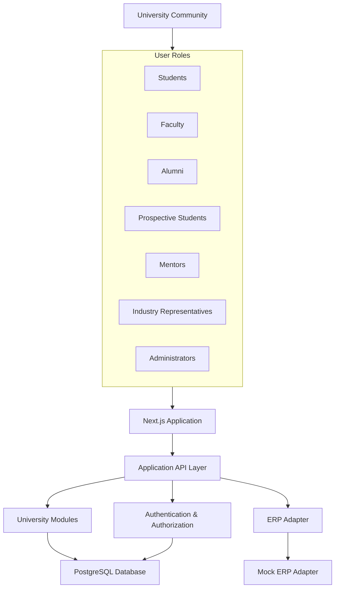

# ONE-SPACE
### One University. One Identity. One Connected Ecosystem.

  
  
  
  
  

  <strong>A unified digital ecosystem designed to connect the entire university community.</strong>
   
  Bringing academics, professional identity, collaboration, mentorship, networking and career opportunities together in one intelligent platform.

  <a href="#-overview">Overview</a> •
  <a href="#-core-modules">Modules</a> •
  <a href="#-architecture">Architecture</a> •
  <a href="#-technology-stack">Tech Stack</a> •
  <a href="#-getting-started">Getting Started</a> •
  <a href="#-roadmap">Roadmap</a>

---

## ◈ Overview

**ONE-SPACE** is a centralized university digital platform that brings students, faculty, alumni, administrators, mentors and industry representatives into one connected environment.

Traditional university systems often operate independently. Academic information, student achievements, professional networking, project collaboration and career opportunities are scattered across different platforms.

ONE-SPACE aims to eliminate this fragmentation through a unified university identity and an integrated digital experience.

### Our Vision

> Transform the university experience from disconnected services into one collaborative, intelligent and professionally connected ecosystem.

### What makes ONE-SPACE different?

| Traditional University Experience | ONE-SPACE Approach |
|---|---|
| Fragmented student information | Unified University Profile |
| Isolated academic systems | Centralized Academic Hub |
| Disconnected student communities | Integrated University Networking |
| Unverified skill claims | Mentor-assisted verification |
| Limited project visibility | Project collaboration and evaluation |
| Scattered career opportunities | Centralized Career & Opportunities |
| Limited alumni engagement | Alumni and mentorship ecosystem |

---

## ✦ Core Modules

ONE-SPACE is organized into specialized modules that work together as a unified platform.

### 01. Unified University Profile

A centralized digital identity for every university member.

- Personal and academic information.
- Skills, interests and professional experience.
- Projects and achievements.
- Certifications and verification status.
- Public and private profile visibility.
- Profile correction and approval workflow.

### 02. Academic Hub

A centralized academic information interface.

- Student academic information.
- Course and subject details.
- Attendance and timetable information.
- Academic records.
- University announcements.
- ERP integration architecture.

> **Current integration status:** Academic Hub uses mock ERP data. A real university ERP integration requires an institution-specific adapter.

### 03. Project Nexus

A collaborative environment for university projects.

- Create and publish projects.
- Unique project titles.
- Discover projects across departments.
- Project collaboration and crew management.
- Join requests and participation.
- Project submission and evaluation.
- Revaluation workflow with a cooling period.

### 04. Communities

A structured university community ecosystem.

- Create and discover communities.
- University clubs and interest groups.
- Membership requests and approvals.
- Community discussions and posts.
- Administrative moderation.

### 05. Mentorship

Connect students with experienced individuals.

- Discover mentors.
- Mentorship requests.
- Mentor profiles and expertise.
- Structured mentorship interactions.

### 06. Career & Opportunities

A centralized opportunity discovery platform.

- Internship and job opportunities.
- Alumni and industry-submitted opportunities.
- Administrative approval workflow.
- Student applications.
- Save and discover opportunities.
- Application status tracking.

### 07. University Networking

Build meaningful connections across the university.

- Discover students, faculty and alumni.
- Search by skills, expertise and interests.
- Personal message before connection invitations.
- Connection invitation management.
- Cross-department networking.

### 08. Admissions

A dedicated experience for prospective students.

- Prospective student registration.
- Email OTP verification.
- Restricted prospective account access.
- Administrative verification and conversion workflow.

### 09. Administration

Centralized institutional governance.

- User and role management.
- Verification management.
- Profile correction approvals.
- Community administration.
- Opportunity approvals.
- Administrative overview and controls.

---

## 🏛️ Platform Architecture

ONE-SPACE follows a modular application architecture built around Next.js and PostgreSQL.

### High-Level Architecture

### Authentication & Authorization

ONE-SPACE uses role-aware access control to support different university responsibilities.

- Primary user roles.
- Secondary role assignments.
- Role-based authorization.
- Email OTP verification.
- Password hashing.
- Restricted prospective student accounts.

### Data Layer

- PostgreSQL database hosted on Neon.
- Prisma ORM for database access.
- Schema-driven data modeling.
- Version-controlled database migrations.

---

## ⚙️ Technology Stack

| Layer | Technology |
|---|---|
| Frontend Framework | Next.js 16 |
| UI Library | React 19 |
| Programming Language | TypeScript |
| Styling | Tailwind CSS 4 |
| Backend | Next.js App Router API |
| Database | PostgreSQL |
| Database Hosting | Neon |
| ORM | Prisma 7 |
| Authentication | Custom authentication and OTP workflows |
| Email Service | Nodemailer with SMTP |
| Testing | Vitest |
| Version Control | Git & GitHub |
| Deployment Target | Vercel |

---

## 🏛️ User Roles

ONE-SPACE supports a multi-role university environment.

| Role | Primary Responsibility |
|---|---|
| Student | Academic profile, projects, networking and opportunities |
| Faculty | Academic participation and verification |
| Alumni | Professional engagement and mentorship |
| Prospective Student | Pre-admission registration and verification |
| Mentor | Expertise and mentorship |
| Administrator | Institutional governance and approvals |
| Placement Officer | Career and placement coordination |
| Industry Representative | Industry opportunities and engagement |
| Proctor | Student-related institutional responsibilities |
| Project Analysis Crew | Project evaluation and review
